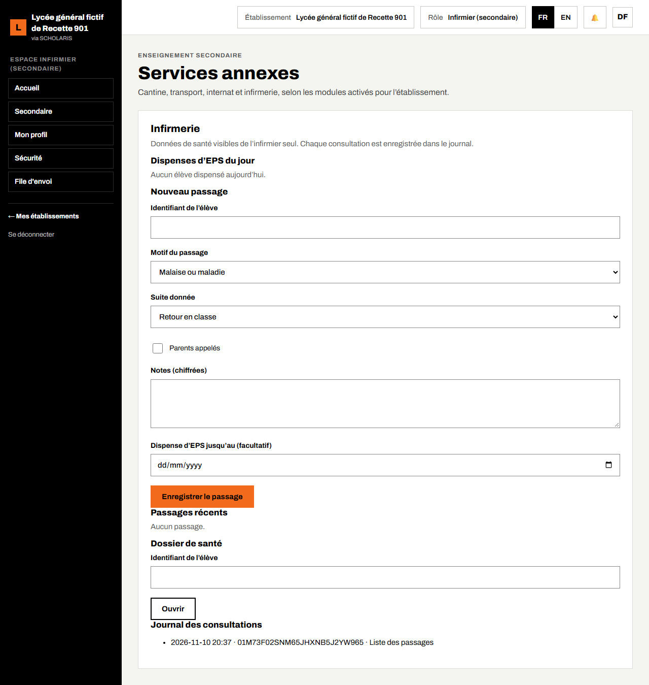
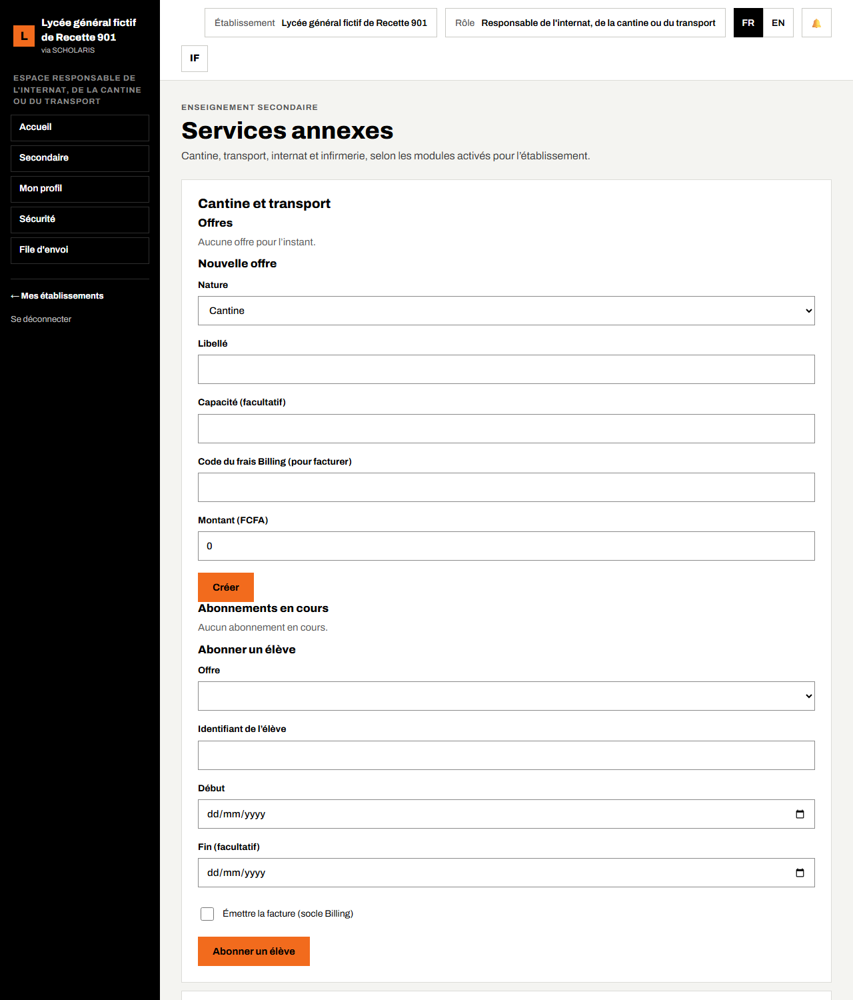
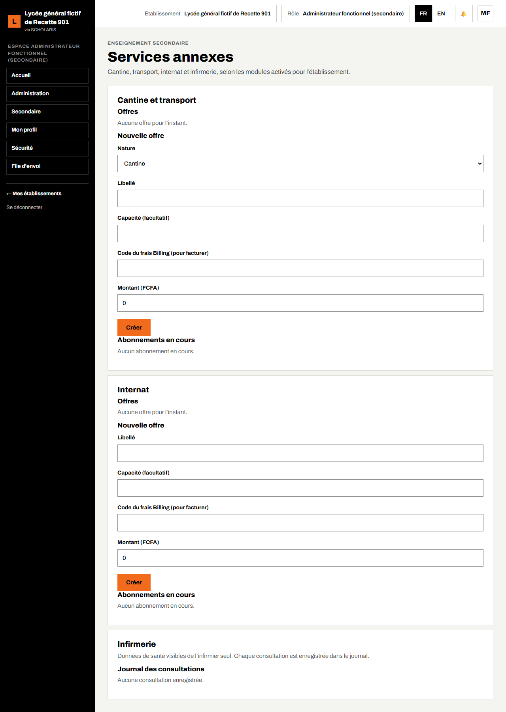

# 13. Services : infirmerie, cantine, transport, internat, bibliothèque

Ce chapitre explique l'écran **Services annexes**. Il n'affiche que les services dont le module est actif dans le profil (chapitre 02) et que votre rôle gère.

**Où** : **Secondaire > Services** (`/secondaire/services`).

**Qui fait quoi**

| Service | Qui |
|---|---|
| Infirmerie | Infirmier, **seul** à voir les données de santé |
| Cantine, transport, internat | Responsable de l'internat, de la cantine ou du transport |
| Bibliothèque | Bibliothécaire |
| Vue d'ensemble, facturation des abonnements | Intendant, administrateur fonctionnel |

Un module coupé reste consultable : « Ce module a été coupé : ses données restent consultables, aucune modification n'est possible. »

## 13.1 Infirmerie

« Données de santé visibles de l'infirmier seul. Chaque consultation est enregistrée dans le journal. »

1. **Dispenses d'EPS du jour** : la liste des élèves dispensés aujourd'hui.
2. **Nouveau passage** :
   - saisissez l'**Identifiant de l'élève** ;
   - choisissez le **Motif du passage** (par exemple **Malaise ou maladie**) et la **Suite donnée** (par exemple **Retour en classe**) ;
   - cochez **Parents appelés** si c'est le cas ;
   - saisissez vos **Notes** (elles sont chiffrées) et, si besoin, la **Dispense d'EPS jusqu'au** ;
   - cliquez sur **Enregistrer le passage**.
3. **Passages récents** : les derniers passages.
4. **Dossier de santé** : saisissez l'identifiant de l'élève puis cliquez sur **Ouvrir**.
5. **Journal des consultations** : qui a consulté quoi, et quand.

Remarque : cette version demande l'**identifiant** de l'élève (et non son nom). Demandez-le à la scolarité.

## 13.2 Cantine et transport

1. **Nouvelle offre** : choisissez la **Nature** (**Cantine** ou **Transport**), saisissez le **Libellé**, la **Capacité (facultatif)**, le **Code du frais** utilisé pour facturer et le **Montant (FCFA)**, puis cliquez sur **Créer**.
2. **Abonner un élève** : choisissez l'**Offre**, saisissez l'identifiant de l'élève, le **Début** et la **Fin (facultatif)**. Cochez **Émettre la facture** pour facturer la famille. Cliquez sur **Abonner un élève**.
3. **Abonnements en cours** : la liste des élèves abonnés. Le parent voit l'abonnement sur son portail (rubrique **Services**).

## 13.3 Internat et bibliothèque

- **Internat** : chambres et suivi des internes (affectation d'un élève à une chambre).
- **Bibliothèque** : prêts et retours d'ouvrages.

Les formulaires suivent la même logique que la cantine : choisir, saisir, enregistrer.

