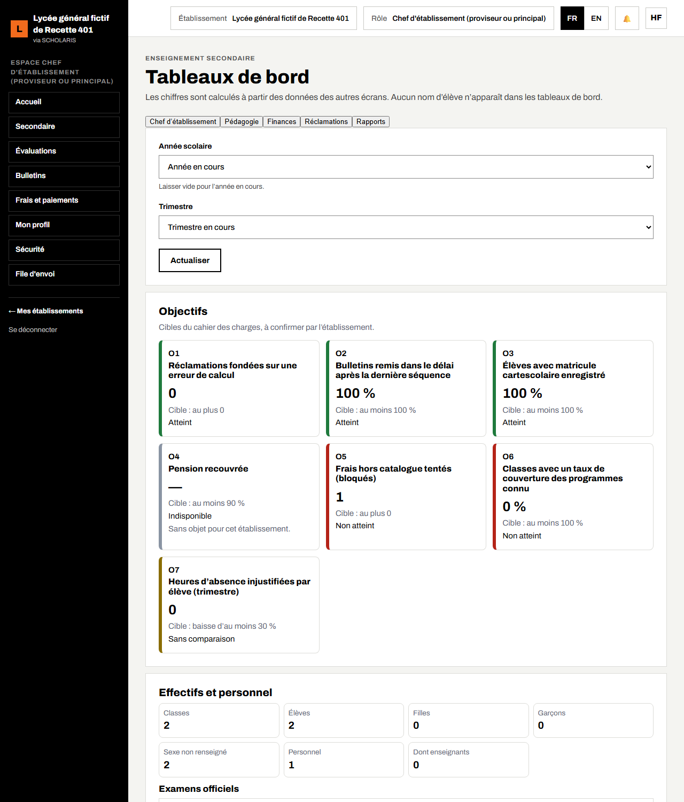
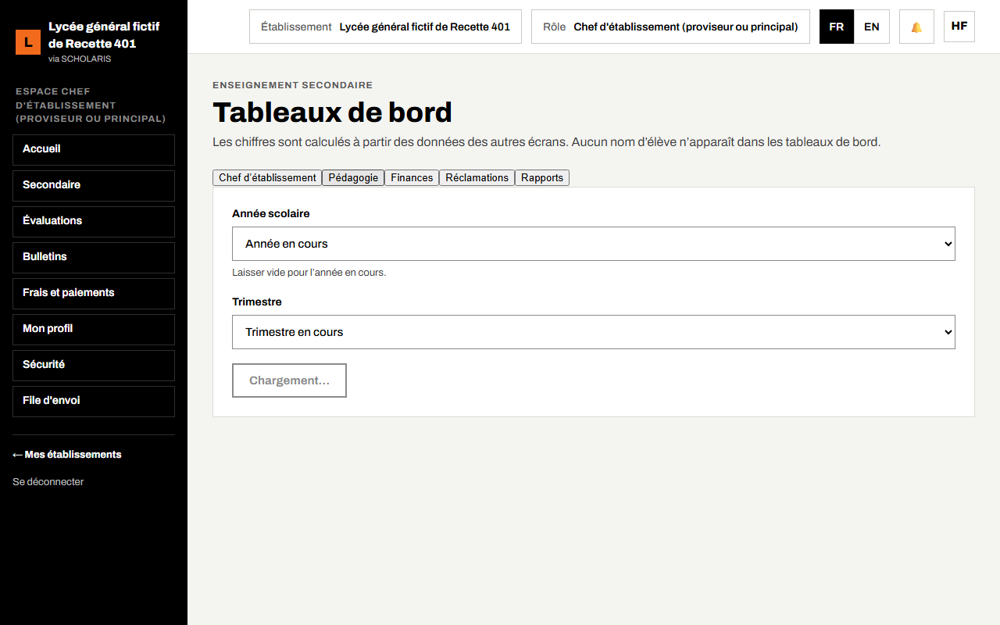
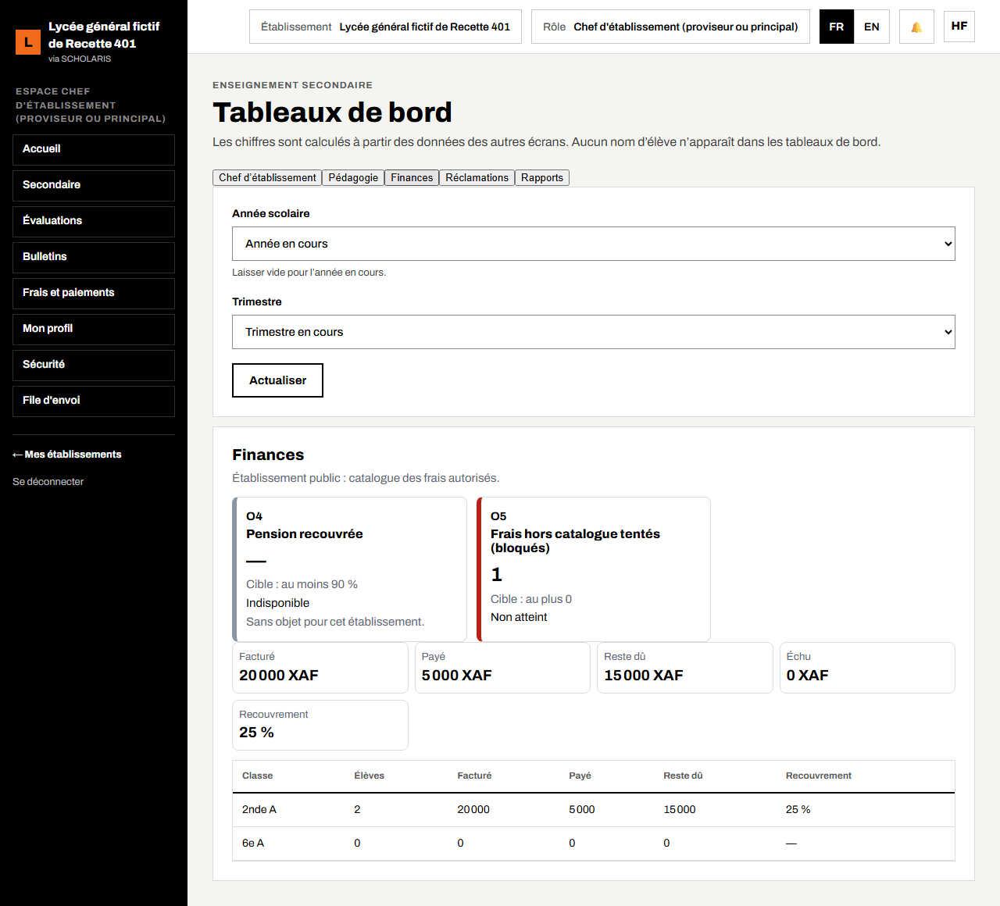
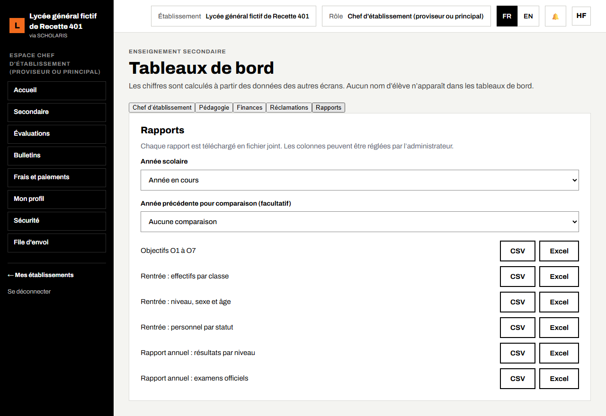

# 14. Tableaux de bord

Ce chapitre présente les tableaux de bord de la direction : objectifs de l'établissement, effectifs, pédagogie, finances, réclamations et rapports à télécharger.

**Où** : **Secondaire > Tableaux de bord** (`/secondaire/tableaux-de-bord`).

**Qui** : chef d'établissement, censeur, surveillant général, professeur principal, intendant, promoteur, responsable de réseau. Chacun ne voit que les onglets de son rôle. « Aucun nom d'élève n'apparaît dans les tableaux de bord. »

## 14.1 Choisir la période

1. Ouvrez **Secondaire > Tableaux de bord**.
2. Choisissez l'**Année scolaire** dans la liste (l'année en cours est proposée).
3. Choisissez le **Trimestre** (par défaut **Trimestre en cours**).
4. Cliquez sur **Actualiser**.

## 14.2 Onglet Chef d'établissement

Le bloc **Objectifs** affiche sept cartes (O1 à O7), avec la valeur, la **Cible** et l'état (**Atteint**, **Non atteint**, **Indisponible**, **Sans comparaison**) :

| Objectif | Ce qu'il mesure |
|---|---|
| O1 | Réclamations fondées sur une erreur de calcul (cible : 0) |
| O2 | Bulletins remis dans le délai après la dernière séquence |
| O3 | Élèves avec matricule cartescolaire enregistré |
| O4 | Pension recouvrée (privé) |
| O5 | Frais hors catalogue tentés (bloqués) (public) |
| O6 | Classes avec un taux de couverture des programmes connu |
| O7 | Heures d'absence injustifiées par élève (trimestre) |

Les cibles sont celles du cahier des charges, **à confirmer par l'établissement**.

Le bloc **Effectifs et personnel** donne le nombre de classes, d'élèves (filles, garçons), de personnels et d'enseignants ; le bloc **Examens officiels** résume les résultats.

## 14.3 Autres onglets

- **Pédagogie** : moyennes, réussite et couverture des programmes par classe.
- **Finances** : facturé, encaissé, reste à recouvrer (intendant, promoteur).
- **Réclamations** : réclamations sur les notes et leur suite.
- **Rapports** : rapports à télécharger en **CSV** ou **Excel**.

