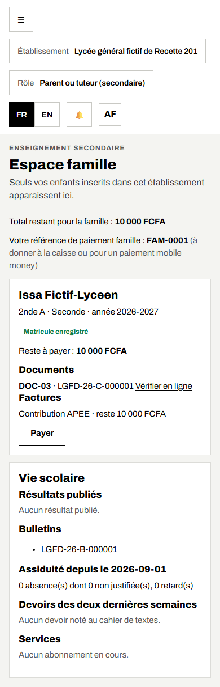
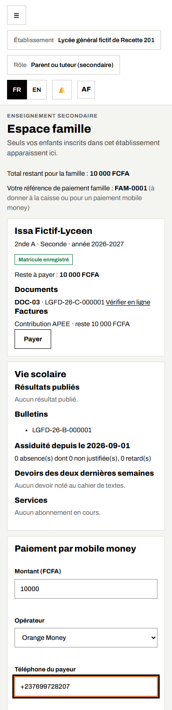
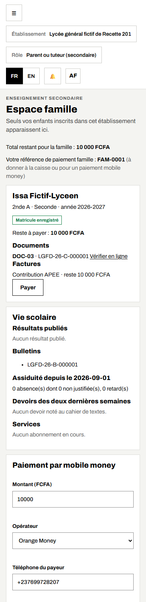
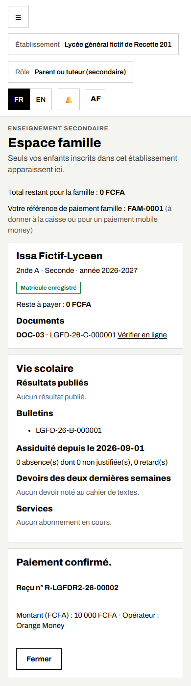
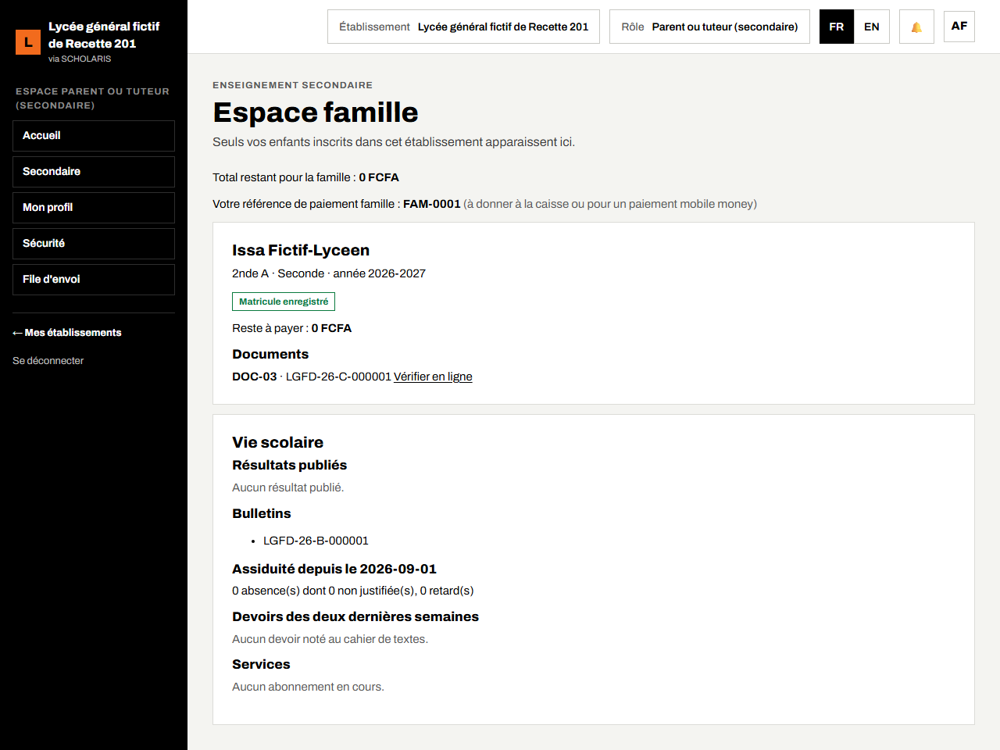
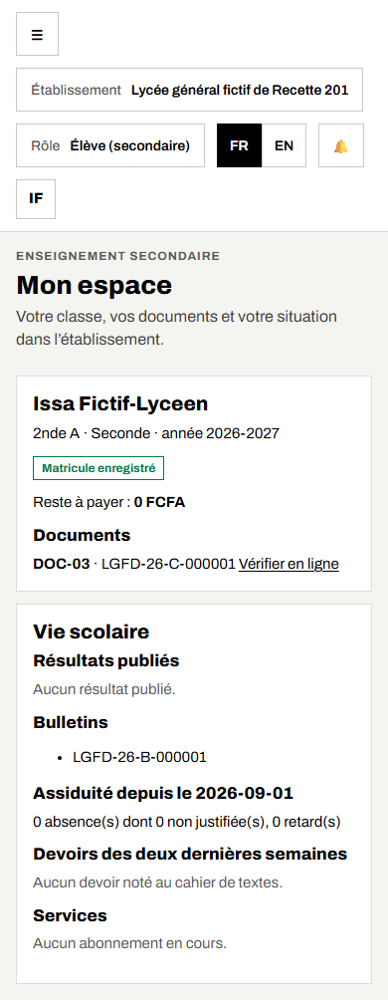
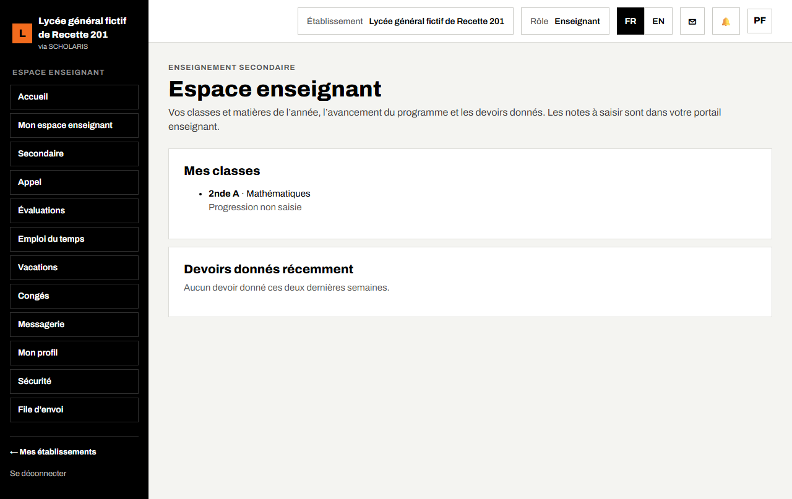

# 15. Portails parent, élève et enseignant

Ce chapitre explique ce que voient les parents, les élèves et les enseignants dans leur espace, et comment un parent paie par mobile money.

**Où** : **Secondaire > Espace famille** (`/secondaire/famille`), **Secondaire > Mon espace** (`/secondaire/mon-espace`) et **Secondaire > Espace enseignant** (`/secondaire/espace-enseignant`).

Ces espaces sont pensés pour le **téléphone**. Sur un téléphone, touchez **☰** en haut à gauche pour ouvrir le menu.

## 15.1 Espace famille (parent ou tuteur)

**Qui** : le parent ou tuteur, avec son propre compte (activé par SMS, chapitre 01).

« Seuls vos enfants inscrits dans cet établissement apparaissent ici. » Un enfant n'apparaît que si le parent est son **garant financier** (chapitre 03).

Pour chaque enfant, la carte affiche :

- la **classe**, le **niveau** et l'**année** (par exemple « 2nde A · Seconde · année 2026-2027 ») ;
- l'état du matricule (**Matricule enregistré** ou **Matricule en attente**) ;
- le **Reste à payer** et la liste des **Factures** ;
- les **Documents** émis (certificat de scolarité, carte…) ;
- la **Vie scolaire** : **Résultats publiés**, **Bulletins**, **Assiduité** (absences, non justifiées, retards), **Devoirs des deux dernières semaines** (cahier de textes) et **Services** (cantine, transport).

En haut : **Total restant pour la famille**, puis **Votre référence de paiement famille** (par exemple **FAM-0587**), « à donner à la caisse ou pour un paiement mobile money ». Le parent ne voit que sa propre référence. Si la caisse ne la lui a pas encore attribuée : « Votre référence de paiement famille n'est pas encore attribuée : demandez-la à la caisse ou au secrétariat. »

Un élève majeur peut refuser l'accès de ses parents à ses documents : « Élève majeur : il n'a pas autorisé l'accès de ses parents à ses documents. »

### SMS « bulletin disponible »

Quand l'établissement publie les bulletins du conseil de classe (chapitre 08), le parent reçoit **un SMS par bulletin**, une seule fois : nom de l'enfant, période, moyenne, rang, décision et lien vers l'espace famille. Ce message de service lui parvient même sans consentement recueilli, sauf s'il s'est désinscrit des SMS ou a retiré son consentement. Le bulletin reste visible dans la rubrique **Bulletins**, SMS reçu ou non.

## 15.2 Payer par mobile money

1. Sous la facture, touchez **Payer**.
2. Le formulaire **Paiement par mobile money** s'ouvre. Saisissez le **Montant (FCFA)** (au plus le reste dû), choisissez l'**Opérateur** (**Orange Money** ou **MTN MoMo**) et le **Téléphone du payeur**.
3. Touchez **Envoyer la demande**.

4. Message : « Confirmez le paiement sur votre téléphone. » Vous recevez la demande de l'opérateur : validez-la avec votre code secret.

5. Touchez **Vérifier l'état**. Dès que l'opérateur confirme, l'écran affiche **Paiement confirmé.**, le **Reçu n°** …, le montant et l'opérateur. Le reste à payer est mis à jour. Touchez **Fermer**.

Si le paiement échoue : « Le paiement n'a pas abouti. » Vous pouvez recommencer. Si le paiement en ligne n'est pas proposé : « réglez auprès de la caisse ».

Sur ordinateur, l'espace famille présente les mêmes informations :

## 15.3 Mon espace (élève)

**Qui** : l'élève, avec son propre compte.

L'élève voit sa **classe**, son **niveau**, l'**année**, l'état de son matricule, ses **Documents** et sa situation (vie scolaire, devoirs, assiduité).

## 15.4 Espace enseignant

**Qui** : l'enseignant. « Vos classes et matières de l'année, l'avancement du programme et les devoirs donnés. »

L'espace regroupe les classes et matières de vos affectations, la couverture du programme et les travaux donnés. Les notes se saisissent dans **Secondaire > Notes** (chapitre 07), l'appel dans **Appel** (chapitre 06), les séances dans **Cahier de textes** (chapitre 05).

