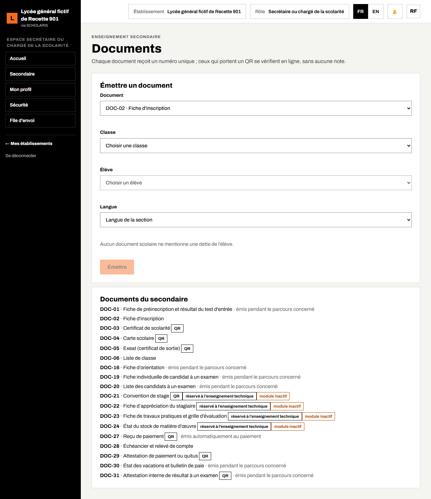
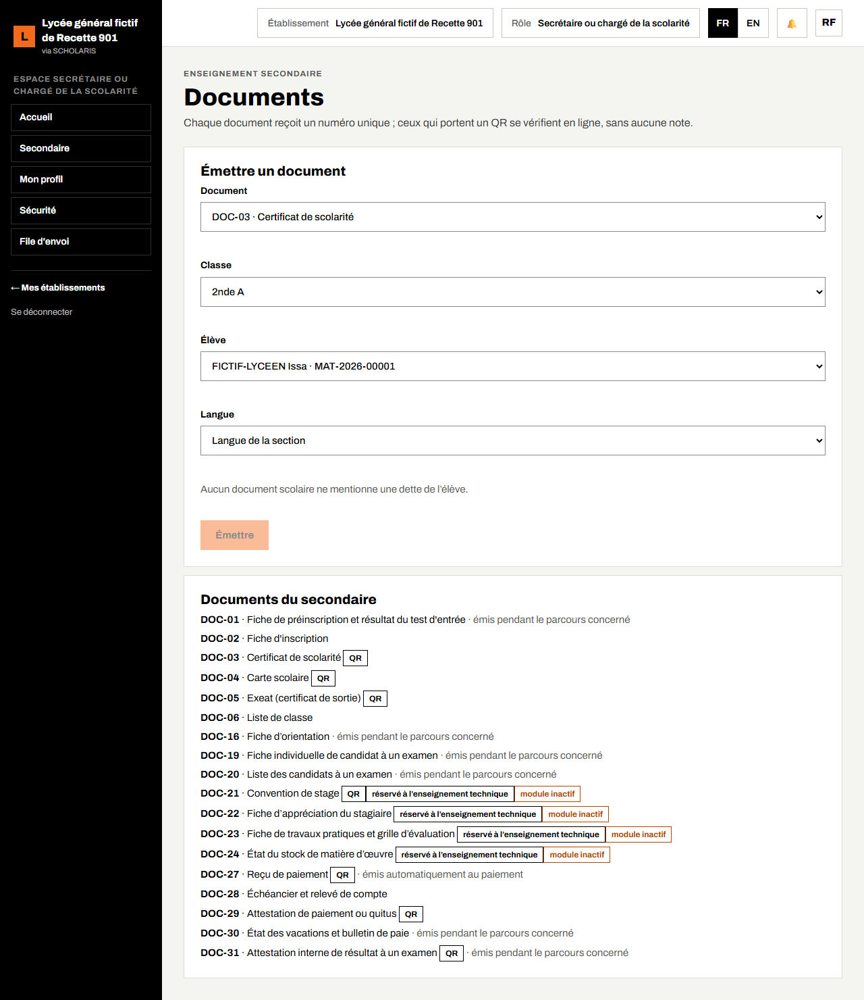
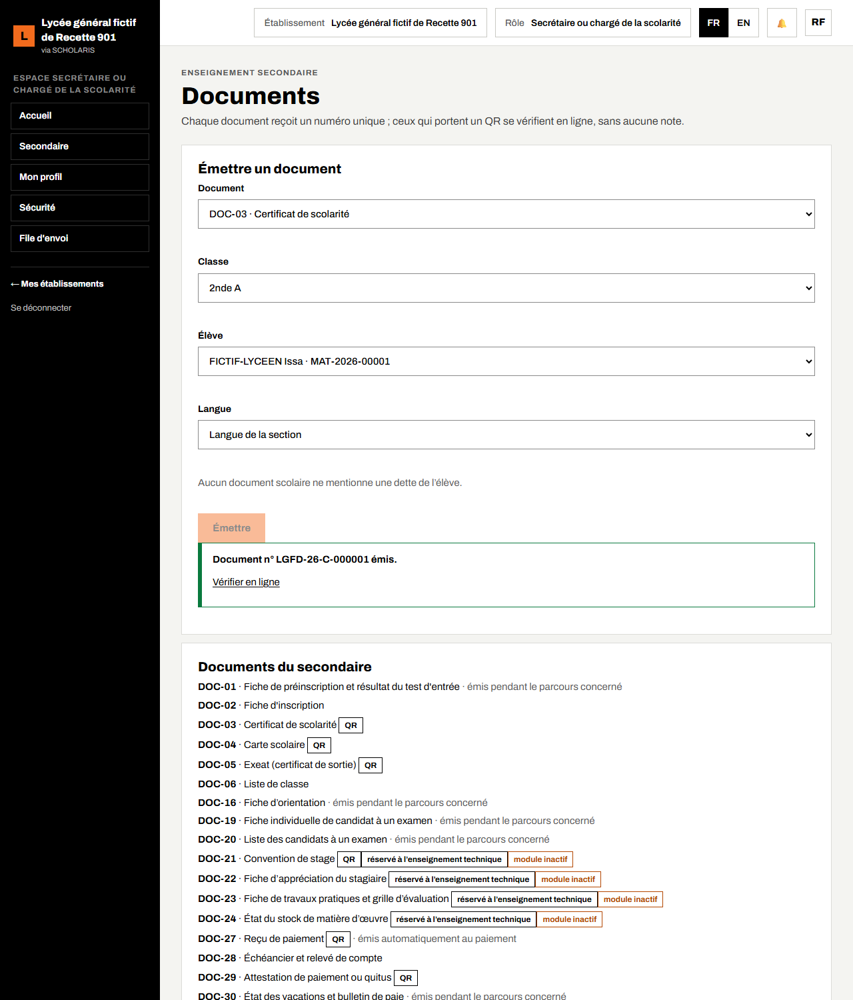

# 16. Documents

Ce chapitre explique comment émettre les documents officiels de l'élève (certificat de scolarité, carte scolaire, exeat, liste de classe, attestation de paiement…) et comment ils se vérifient.

**Où** : **Secondaire > Documents** (`/secondaire/documents`).

**Qui** : la scolarité (documents de l'élève et de la classe), l'intendant (documents liés à une facture : échéancier, attestation de paiement ou quitus). Le chef d'établissement signe les certificats, cartes et exeat ; l'intendant signe l'attestation de paiement.

**Règles**

- Chaque document reçoit un **numéro unique**.
- Ceux qui portent un **QR** se vérifient en ligne (adresse `/verification`), sans aucune note.
- **Aucun document scolaire ne mentionne une dette de l'élève.**
- Le contenu est figé à l'émission ; il est produit en français ou en anglais (par défaut, la langue de la section).

## 16.1 Le catalogue des documents

Le bas de l'écran liste les **Documents du secondaire** :

| Document | Remarque |
|---|---|
| DOC-01 Fiche de préinscription et résultat du test d'entrée | émis pendant la préinscription |
| DOC-02 Fiche d'inscription | |
| DOC-03 Certificat de scolarité | avec QR |
| DOC-04 Carte scolaire | avec QR |
| DOC-05 Exeat (certificat de sortie) | avec QR, après un transfert sortant |
| DOC-06 Liste de classe | |
| DOC-16 Fiche d'orientation | émise avec la décision d'orientation |
| DOC-19, DOC-20 Fiche et liste des candidats à un examen | émises à l'écran des examens |
| DOC-21 à DOC-24 Convention de stage, appréciation du stagiaire, travaux pratiques, stock de matière d'œuvre | réservés à l'enseignement technique |
| DOC-27 Reçu de paiement | avec QR, émis automatiquement au paiement |
| DOC-28 Échéancier et relevé de compte | |
| DOC-29 Attestation de paiement ou quitus | avec QR |
| DOC-30 État des vacations et bulletin de paie | émis à l'écran de la paie |
| DOC-31 Attestation interne de résultat à un examen | avec QR |

Les étiquettes **module inactif** ou **réservé à l'enseignement technique** signalent les documents indisponibles pour votre établissement.

## 16.2 Émettre un document

1. Dans **Émettre un document**, choisissez le **Document** (par exemple **DOC-03 · Certificat de scolarité**).
2. Choisissez la **Classe**, puis l'**Élève**.
3. Pour l'exeat, saisissez l'**Établissement de destination**, le **Motif** et la **Date de sortie**. « L'exeat n'est délivré qu'après la clôture de l'inscription par le transfert. »
4. Pour un document lié à une facture, saisissez le **Numéro de la facture**.
5. Choisissez la **Langue** (ou laissez **Langue de la section**).
6. Cliquez sur **Émettre**. Message : « Document n° … émis. »
7. Ouvrez le document pour l'imprimer, ou cliquez sur **Vérifier en ligne** pour voir sa page de vérification.

Le bloc **Documents valides de l'élève** liste les documents déjà émis pour l'élève choisi.

## 16.3 Vérifier un document

Toute personne (une administration, un autre établissement) peut scanner le **QR** du document avec un téléphone : la page de vérification de SCHOLARIS indique si le document est authentique, son numéro, sa date et l'établissement émetteur.
